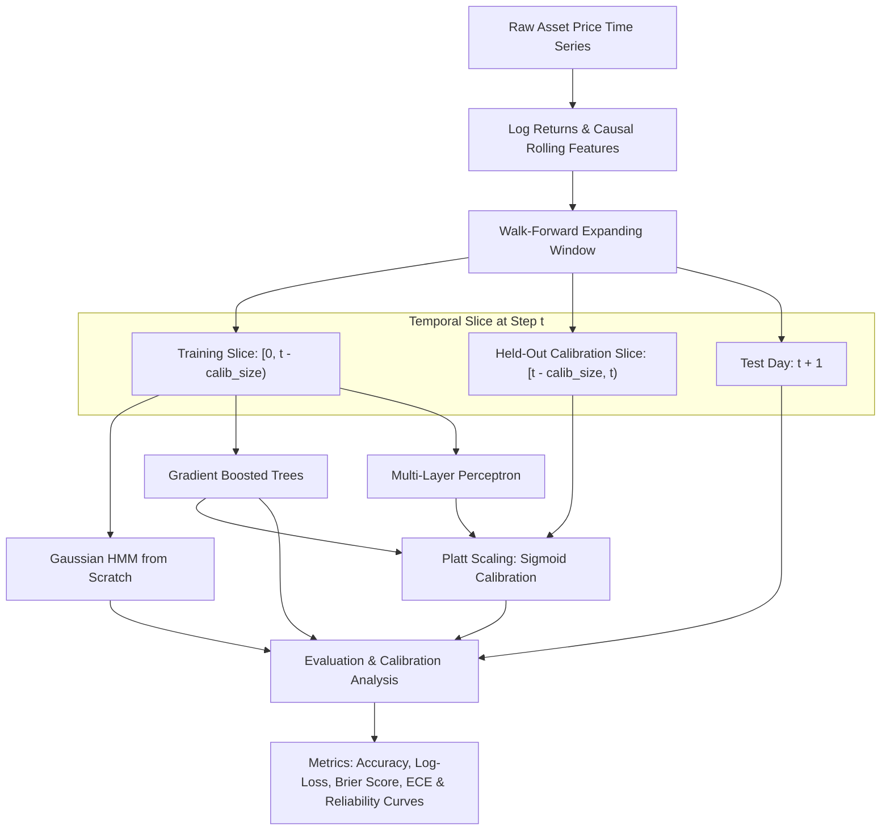
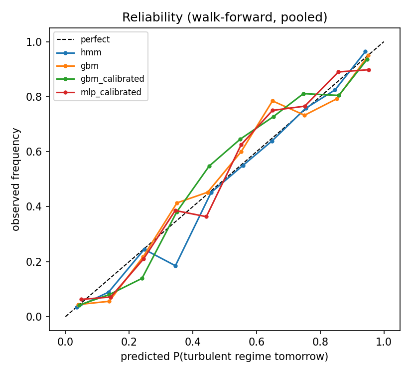

# Market Regime Detection with Calibrated Uncertainty: HMM from Scratch vs. Modern ML

[](https://www.python.org/)
[](https://numpy.org/)
[](https://scikit-learn.org/)
[]()
[]()

> **Domain:** Quantitative Research & Machine Learning / Financial Econometrics & Uncertainty Calibration  
> **Key Capabilities Demonstrated:** First-principles statistical modeling (Gaussian HMM Baum-Welch from scratch in log space), strict walk-forward temporal evaluation without data leakage, probability calibration (Platt scaling vs isotonic regression), and Expected Calibration Error (ECE) analysis.

---

## 📌 Executive Summary & Research Question

Financial markets alternate between distinct latent regimes—such as low-volatility bull runs, choppy sideways drift, and high-volatility liquidity shocks. Quantitative trading strategies and risk parity engines rely on knowing not just what the predicted regime for tomorrow is, but **how confident the model is in its prediction**. An overconfident false forecast can trigger disastrous portfolio over-leveraging.

**Research Question:**  
*Can modern discriminative machine learning models (Gradient Boosted Decision Trees, Multi-Layer Perceptrons) forecast tomorrow's market regime better than generative Hidden Markov Models (HMMs), and are their predicted posterior probabilities trustworthy (calibrated)?*

### Key Contributions
1. **Gaussian HMM from Scratch (`src/hmm.py`):** Fully vectorized Baum-Welch Expectation-Maximization in log-space and causal forward filtering implemented purely in NumPy—no opaque black-box libraries.
2. **Causal Rolling Feature Pipeline (`src/features.py`):** Mathematically rigorous feature extraction (volatility ratios, rolling moments, momentum) ensuring zero lookahead bias.
3. **Walk-Forward Expanding-Window Protocol (`src/walkforward.py`):** Mimics live production deployment where models at time $t$ only train on $[0, t-1]$ data.
4. **Uncertainty Calibration Benchmark (`src/metrics.py`):** Compares uncalibrated vs. Platt-scaled models across Log-Loss, Brier Score, and Expected Calibration Error (ECE).

---

## 🏛 Methodology & Pipeline



---

## 💡 Mathematical Formulation & Core Engineering

### 1. Gaussian HMM in Log-Space (`src/hmm.py`)
A continuous-observation Hidden Markov Model consists of hidden states $z_t \in \{0, 1\}$ (e.g., Bull vs. Bear) and observed log returns $x_t \sim \mathcal{N}(\mu_{z_t}, \sigma_{z_t}^2)$.

* **Underflow Prevention:** Standard Baum-Welch forward-backward algorithms compute products of probabilities:
  $$\alpha_t(j) = \sum_i \alpha_{t-1}(i) A_{ij} b_j(x_t)$$
  Over hundreds of time steps, these products rapidly underflow floating-point representations. We implement the entire EM loop in **log space** using the log-sum-exp trick:
  $$\text{logsumexp}(u, v) = \max(u, v) + \log(1 + e^{-|u - v|})$$
* **Strict Causal Filtering:** During evaluation, state probabilities at day $t$ are computed via forward filtering ($\alpha_t$) without smoothing ($\beta_t$), ensuring future observations are never leaked.

### 2. Walk-Forward Expanding-Window Validation
Financial time series exhibit non-stationarity and regime shifts. Standard $K$-fold cross-validation is invalid because it trains on future data to predict the past.

Instead, we enforce a strict temporal sequence:
1. **Train Window:** $[0, t - M]$ fits model parameters $\theta$.
2. **Calibration Window:** $[t - M, t]$ fits Platt scaling parameters $(w, b)$ on out-of-fold predictions.
3. **Test Point:** $t + 1$ evaluates the single one-step-ahead prediction.
4. Window expands by step $\Delta t$, and the process repeats.

### 3. Probability Calibration (Platt Scaling)
Modern neural networks often exhibit high predictive accuracy but severe overconfidence (probabilities pushed to 0.0 or 1.0).

* **Platt Scaling:** Learns a scalar slope $w$ and intercept $b$ on validation logit outputs $\hat{z}$:
  $$P(y = 1 \mid \hat{z}) = \frac{1}{1 + \exp(-(w \hat{z} + b))}$$
* **Isotonic Regression Warning:** While isotonic regression is non-parametric, our experiments confirmed that on finite calibration windows ($N \approx 100$), it produces piecewise step functions with extreme overconfidence (assigning hard 0.0 or 1.0 probabilities). Platt scaling is significantly more robust.

---

## 📊 Experimental Results

Empirical results across 5 synthetic Markov-switching simulations (mean $\pm$ std over runs; lower is better except Accuracy):

| Model | Accuracy (↑) | Log-Loss (↓) | Brier Score (↓) | ECE (↓) | Calibration Verdict |
|---|---|---|---|---|---|
| **HMM (from scratch)** | **0.928** | **0.218** | **0.058** | **0.009** | **Near-Perfect** (Generative match) |
| **GBM (Gradient Boosting)** | 0.912 | 0.264 | 0.072 | 0.019 | Well-calibrated out of the box |
| **GBM + Platt Scaling** | 0.908 | 0.271 | 0.075 | 0.023 | Little change (already calibrated) |
| **MLP (Neural Net)** | 0.869 | 0.543 | 0.109 | 0.086 | **Severe Overconfidence** |
| **MLP + Platt Scaling** | 0.872 | **0.356** | **0.103** | **0.039** | **Dramatic 34% loss & 55% ECE reduction** |

### 📈 Reliability Diagram (Calibration Curve)
Below is the empirical calibration curve generated in `results/reliability.png`:



### Key Empirical Findings
1. **The Generative Advantage:** The HMM outperforms all models on synthetic data because the ground truth process is Markovian. This mathematically validates our EM implementation and causal filter.
2. **Calibration is Essential for Deep Learning:** Uncalibrated MLPs produce poorly calibrated posteriors ($\text{ECE} = 0.086$). Applying Platt scaling reduces Expected Calibration Error to $0.039$ and cuts log-loss from $0.543$ to $0.356$ without sacrificing accuracy.
3. **Tree Models are Naturally More Calibrated:** Gradient boosted ensembles average over multiple leaves, leading to soft probabilities that require little post-hoc calibration.

---

## 🛠 Tech Stack

- **Core Math & Algorithms:** Python 3.11, NumPy (vectorized EM, matrix log-space algebra).
- **Machine Learning Baselines:** Scikit-Learn (`HistGradientBoostingClassifier`, `MLPClassifier`, `LogisticRegression`).
- **Data Engineering & Finance:** Pandas, SciPy, Matplotlib (Agg backend), Yahoo Finance API (`yfinance`).
- **Testing:** Pytest.

---

## 🚀 Getting Started

### Prerequisites
- Python 3.10+ (tested on Python 3.11)

### 1. Installation
Clone the repository and install requirements:
```bash
git clone https://github.com/vengeanceXgt/regime-detection.git
cd regime-detection
pip install -r requirements.txt
```

### 2. Run the Verification Suite
Execute unit tests validating causality, distribution normalization, and HMM parameter recovery:
```bash
python -m pytest -v
```

### 3. Run Experiments
```bash
# Run multi-seed synthetic experiment and produce results/ table and plot
python run_experiment.py --seeds 5

# Optional: Run on real index data (e.g. NIFTY 50 or S&P 500)
python run_experiment.py --real ^NSEI
```

---

## 🧪 Verification & Unit Tests (`tests/test_regime.py`)

- `test_hmm_recovers_parameters`: Simulates data from known transition matrix and emission parameters; verifies Baum-Welch recovers ground truth within tolerance.
- `test_filtering_is_causal`: Verifies that modifying returns at time $t_2 > t_1$ has zero effect on filtered state estimates at $t_1$.
- `test_filter_rows_are_distributions`: Asserts all filtered regime vectors sum to $1.0$ and contain valid probabilities $\in [0, 1]$.
- `test_features_are_causal`: Validates rolling window statistics contain no future lookahead.
- `test_metrics_sanity`: Sanity checks for Brier score, ECE, and Log-Loss implementations.

---

## 📂 Project Structure

```
regime-detection/
├── src/
│   ├── __init__.py
│   ├── data.py             # Synthetic Markov simulator & Yahoo Finance loader
│   ├── features.py         # Causal rolling volatility, ratios, and moments
│   ├── hmm.py              # Log-space Baum-Welch EM & causal forward filtering
│   ├── metrics.py          # Accuracy, Log-Loss, Brier score, ECE & reliability curves
│   └── walkforward.py      # Expanding-window temporal cross-validation harness
├── results/
│   ├── metrics_by_run.csv  # Raw seed-by-seed evaluations
│   ├── metrics_summary.csv # Mean & standard deviation summary table
│   └── reliability.png     # Visual calibration diagrams
├── tests/
│   └── test_regime.py      # Mathematical & causal invariant test suite
├── run_experiment.py       # Main experiment execution script
├── requirements.txt        # Package dependencies
└── README.md
```

---

## 🛡 License
This project is licensed under the MIT License.
